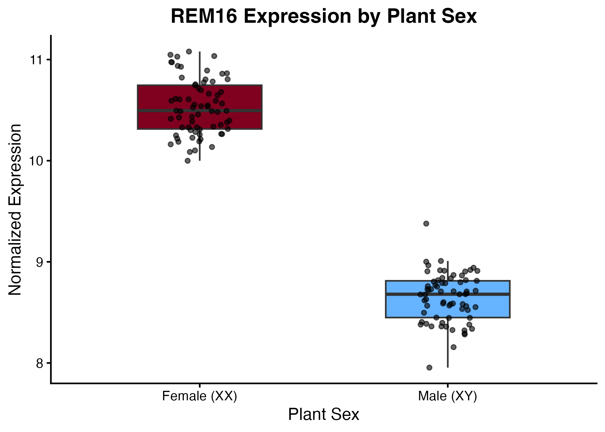
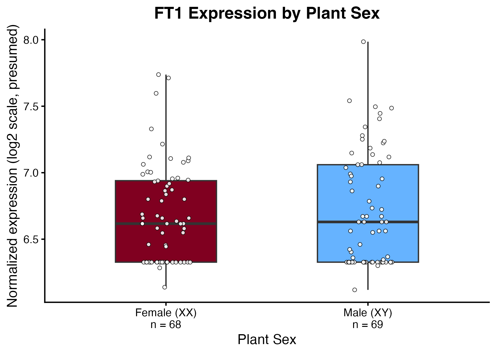
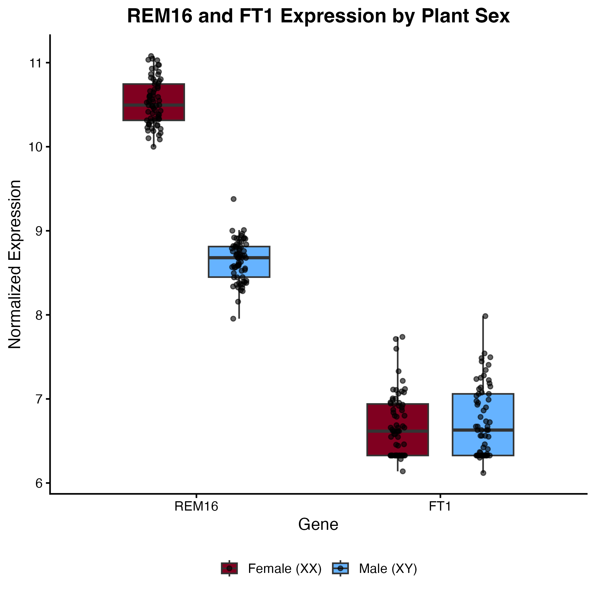

# BVG7003 – Assignment 1
## REM16 and FT1 Expression Analysis in *Cannabis sativa*

**Contents**

1. [Project Overview](#1-project-overview)
2. [Dataset](#2-dataset)
3. [Repository Structure](#3-repository-structure)
4. [Software and Package Setup](#4-software-and-package-setup)
5. [How to Run the Analysis](#5-how-to-run-the-analysis)
6. [Data Quality Checks and Processing](#6-data-quality-checks-and-processing)
7. [Figures](#7-figures)
8. [Results and Biological Interpretation](#8-results-and-biological-interpretation)
9. [Reproducibility and Limitations](#9-reproducibility-and-limitations)
10. [Video Walkthrough](#10-video-walkthrough)

### 1. Project Overview

This project investigates the expression patterns of two candidate sex-associated genes in *Cannabis sativa*: **REM16** (`LOC115699937`) and **FT1** (`LOC115696989`).

The goal is to compare their normalized expression values between female (XX) and male (XY) plants, visualize the distributions, and assess which gene could serve as a sex marker, using reproducible R code.

The analysis produces three figures (a REM16 box plot, an FT1 box plot, and a combined comparison of both genes by plant sex) and a Wilcoxon rank-sum test for each gene.

### 2. Dataset

The input file is `data/2_Data_RNASeq_Cannabis_Sex.csv`, a **processed, normalized gene-expression matrix**, not raw sequencing reads.

It contains:

- **138 plant samples:** 69 XX and 69 XY.
- **20,500 gene/feature rows**, with 20,500 unique identifiers.
- **139 columns:** one gene-identifier column and 138 sample-expression columns.

Rows represent genes or annotated features; columns such as `005_XX` and `016_XY` represent plant samples. Sample columns are not grouped by sex in the file, so sex is always taken from the sample-name suffix rather than column position.

The first CSV column has no header and is imported by `data.table::fread()` as `V1`.

**Expression scale:** The file does not state the normalization method or units. Values range from about 4.7 to 22.8, with nearly identical column sums across samples, which is consistent with a log2-transformed normalized scale (for example, DESeq2 variance-stabilizing transformation). Because this cannot be confirmed from the file, figures are labelled **Normalized expression (log2 scale, presumed)**, and no TPM or CPM units are assumed.

**Dataset discrepancy:** The assignment description mentions more than 34,000 genes, whereas the supplied CSV contains 20,500 unique gene/feature identifiers. The exact reason has not been verified with the data provider. Two observations suggest the matrix was filtered before distribution: the row count is a round number, and no gene is unexpressed across samples (the lowest gene mean is about 6.3, close to the dataset's per-sample minimum). Gene identifiers follow the NCBI *C. sativa* annotation (`LOC…`), plus 45 organellar genes (e.g., `nad`, `cox`, `atp`, `trn`). Both target genes are present, so the discrepancy does not affect this analysis. **No expression-based gene filtering is performed by this analysis script.**

### 3. Repository Structure

```text
oLLMpiques/
├── Question_1/                 # Task 1 in-class deliverables
├── Question_2/                 # Task 2 in-class deliverables
├── Question_4/                 # Task 4 – high-throughput sexing protocol proposal
├── code/
│   └── Task3_Analysis.R        # Reproducible R analysis
├── data/
│   └── 2_Data_RNASeq_Cannabis_Sex.csv
├── figures/
│   ├── REM16_boxplot.png
│   ├── FT1_boxplot.png
│   └── Combined_boxplot.png
└── README.md
```

The CSV is about 48 MB, below GitHub's 100 MB file limit, so it is stored directly in the repository.

### 4. Software and Package Setup

Required software and packages:

- [R — Download and Installation](https://cran.r-project.org/) (version 4.0 or later)
- [RStudio Desktop — Download and Installation](https://posit.co/download/rstudio-desktop/) (recommended)
- [data.table Documentation](https://cran.r-project.org/package=data.table)
- [ggplot2 Documentation](https://ggplot2.tidyverse.org/)

Install the two required R packages once:

```r
install.packages(c("data.table", "ggplot2"))
```

The analysis was developed and tested with:

| Software | Version |
|---|---|
| R | X.X.X |
| data.table | X.X.X |
| ggplot2 | X.X.X |

Exact versions can be checked with `sessionInfo()`.

### 5. How to Run the Analysis

1. **Clone or download** this repository from GitHub, keeping the folder structure shown above.

2. Open R or RStudio and **set the working directory to the repository root** (`oLLMpiques/`), not the `code/` folder.

   For example:

   ```r
   setwd("/full/path/to/oLLMpiques")
   getwd()
   ```

   Replace the example path with the actual location of the cloned repository.

3. Confirm that the input dataset and script are available:

   ```r
   file.exists("data/2_Data_RNASeq_Cannabis_Sex.csv")
   file.exists("code/Task3_Analysis.R")
   ```

   Both commands should return `TRUE`.

4. Run the entire analysis **from the repository root**:

   ```r
   source("code/Task3_Analysis.R")
   ```

The script reads the CSV file, checks the data, extracts the two target genes, prints group summaries and Wilcoxon test results to the console, and regenerates the three PNG figures in `figures/`.

Successful execution ends with:

```text
Task 3 analysis completed successfully.
```

### 6. Data Quality Checks and Processing

The source CSV is **not overwritten**. All preprocessing is performed in R during analysis.

**Issue 1 — Inconsistent Gene Identifier**

REM16 is recorded as `Cannabis_LOC115699937` rather than `LOC115699937`, unlike all other `LOC…` identifiers in the file. A direct lookup of the locus ID given in the assignment therefore fails.

The script removes a leading `Cannabis_` prefix in a separate `Gene_ID` column, preserving the original identifier in `V1`, and verifies that both target genes are found exactly once.

**Issue 2 — Missing Expression Value**

The FT1 expression value for sample `011_XX` is `NA`. It is the only missing value in the entire matrix.

This observation is excluded from FT1 plotting and testing, without imputation and without removing the plant's REM16 measurement. Imputation was avoided because a single value does not justify introducing assumed data.

There are **276 possible gene-by-sample observations** (2 genes × 138 plants) and **275 valid observations** after excluding this one missing value. The resulting group sizes are shown on the figures.

**Issue 3 — Sex Encoded in Sample Names**

There is no separate sex column. For plotting, the two selected genes are reshaped from wide to long format, and sample IDs ending in `_XX` and `_XY` are labelled **Female (XX)** and **Male (XY)**, respectively. The script stops with an error if any sample name has an unrecognized suffix.

The script checks sample counts (69 XX, 69 XY) and successful figure creation. The input data's original sample columns are not reordered.

### 7. Figures

**Figure 1 — REM16 Expression by Plant Sex**



**Figure 2 — FT1 Expression by Plant Sex**



**Figure 3 — Combined REM16 and FT1 Expression by Plant Sex**



Box plots show the median and interquartile range, with whiskers extending to 1.5 × IQR. Every individual sample is overlaid as a jittered point, so box-plot outlier markers are suppressed to avoid plotting any sample twice. Group sizes (*n*) are shown under each group label.

**Female (XX)** is shown in burgundy and **Male (XY)** in blue. The figures are saved as PNG files at 300 dpi.

### 8. Results and Biological Interpretation

**Gene background**

- **REM16** belongs to the plant-specific REM (REPRODUCTIVE MERISTEM) family of B3-domain transcription factors, several of which are associated with flower and reproductive development.
- **FT1** is a homolog of *FLOWERING LOCUS T*, which encodes the mobile "florigen" signal that promotes the transition to flowering.

**Descriptive statistics and tests**

| Gene | Female (XX) median | Male (XY) median | Valid XX / XY samples | Wilcoxon rank-sum *p* |
|---|---:|---:|---:|---:|
| REM16 | 10.50 | 8.68 | 69 / 69 | < 2.2 × 10⁻¹⁶ (W = 4761) |
| FT1 | 6.62 | 6.63 | 68 / 69 | 0.69 (W = 2252) |

All values in this table are printed to the console by `code/Task3_Analysis.R`.

**REM16** is expressed at higher levels in female than in male plants. The difference in medians is about 1.8 units, which corresponds to roughly a 3.5-fold difference if the presumed log2 scale applies. The two distributions **do not overlap at all**: the lowest female value (10.00) is above the highest male value (9.38). In this dataset, a single expression threshold between these values would classify every plant correctly.

**FT1** shows no detectable difference between sexes: medians are nearly identical and the distributions overlap almost completely. FT1 is also expressed at a very low level. 43 of the 137 valid FT1 values share exactly the same value (6.327), visible as the cluster at the bottom of Figure 2. This value sits close to the per-sample minimum of the dataset, which suggests that FT1 is near the detection floor in many samples. This fits FT1's role as a flowering signal whose expression depends on developmental stage and photoperiod rather than on plant sex.

**Conclusion:** Within this dataset, REM16 is a strong candidate marker for distinguishing female from male plants, whereas FT1 is not informative for sex. This result is the basis of the sexing protocol proposed in `Question_4/`.

**Caveats:** These results describe one dataset. The tests compare distributions but do not measure classification accuracy on new plants. Tissue type, developmental stage, and genotypes are not documented in the file, and the separation has not been validated in an independent sample set or with a targeted assay such as RT-qPCR.

### 9. Reproducibility and Limitations

- The analysis uses relative file paths and can run after cloning the repository, provided the working directory is its root.
- Required packages and versions, input file, output figures, and execution command are documented above.
- The script contains checks for input-file availability, target-gene matching, sex labels, sample counts, missing values, and output-figure creation.
- Expression normalization and any upstream filtering are not reconstructed because their methods are not specified in the supplied CSV.
- The analysis was re-run from a fresh clone of the repository to confirm that all three figures are reproduced without relying on files outside the repository.

### 10. Video Walkthrough

A short video walkthrough of the code, figures, and interpretation is available here: [Video link](https://ADD-LINK-HERE)
